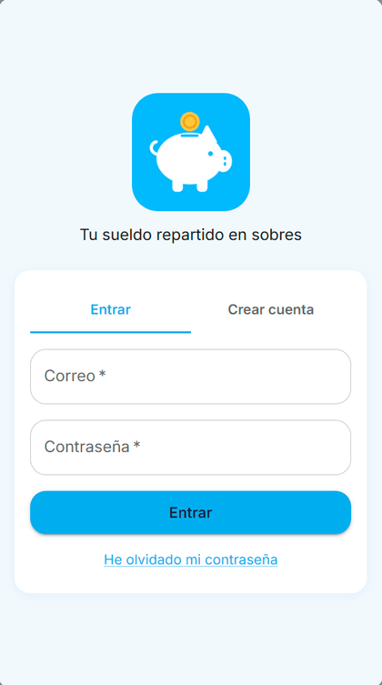
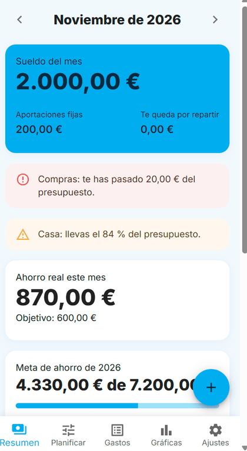
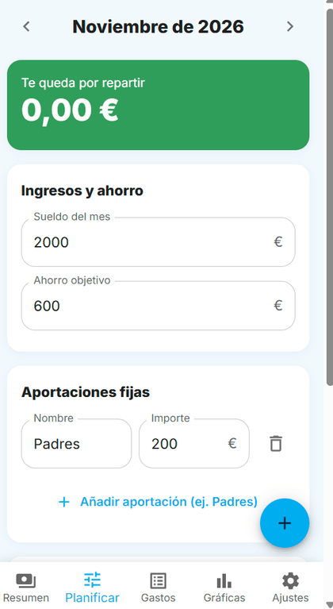
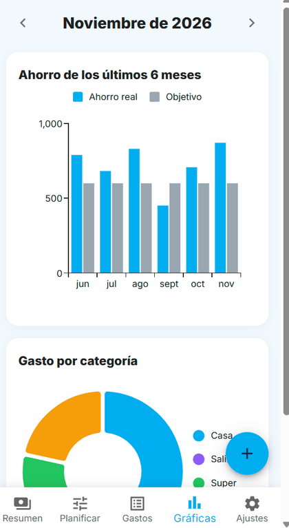
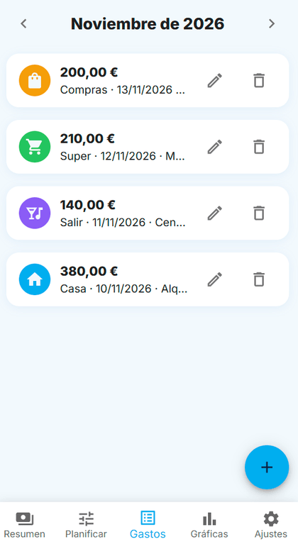
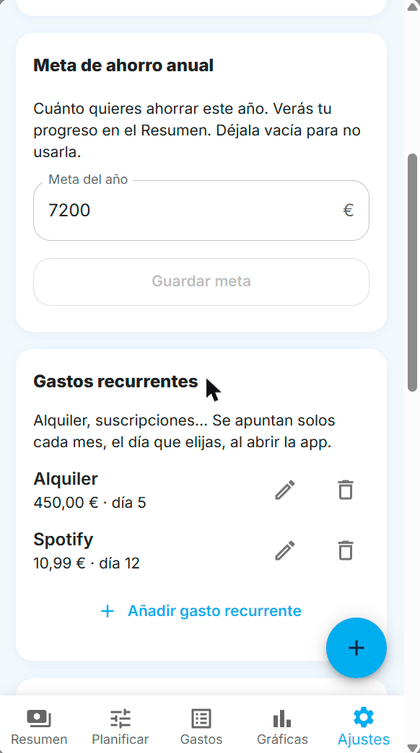
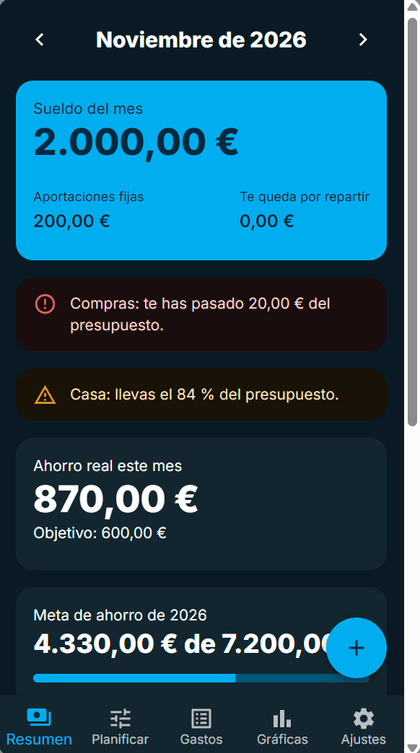

# Stash

Personal monthly budget app. You split your salary into envelopes (a savings goal, fixed contributions and spending categories), log expenses in a couple of taps and always see what is left. Mobile first, installable as a PWA, with your data stored in the cloud under your own account.

<p align="center">
  
  
  
  
</p>

## How it works

The whole app follows one idea: **plan the month once, then log expenses against the plan**.

1. **Plan the month.** Enter your salary, the amount you want to save and your fixed contributions (e.g. money for your parents). Then give every category its budget. The card at the top always shows **how much is left to distribute**: it goes green at 0 € and red if you assigned more than you earn. Each category has a **"Poner resto"** button that fills it with whatever is left, so you never do the math for the last one.
2. **Log expenses.** The **+** button opens a form with the amount ready to type. The category of your last expense is already selected and pressing Enter saves it. A typical expense is: amount, tap a category, Enter.
3. **See where you stand.** The summary shows one card per category with what you spent, what is left and a progress bar. It warns you when a category reaches 80 % of its budget and when it goes over. It also shows your **real savings** (salary - fixed contributions - everything you spent) next to your goal.
4. **Next month.** When you open the app in a month without a plan, it copies the closest earlier plan for you, so you only change what is different (usually just the salary). Each month is independent: editing December never changes November.

<p align="center">
  
  
  
</p>

## Features

| Feature | What it does |
|---|---|
| Monthly plan | Salary, savings goal, fixed contributions and one budget per category, with a live "left to distribute" amount |
| Quick expenses | Amount, category, optional note and date. Remembers your last category and saves with Enter |
| Summary | Budget progress per category, real savings against the goal, month navigation |
| Budget alerts | A warning at 80 % of a category and an alert when it is exceeded |
| Yearly savings goal | Set it in Settings. The summary shows how much of it you have saved so far this year |
| Recurring expenses | Rent, subscriptions... You set them once (name, amount, category, day of the month) and they are logged by themselves each month when you open the app after that day. They are never duplicated, even from two devices |
| Charts | Real savings against the goal for the last 6 months, and spending by category for the selected month |
| Categories | Your own names, icons and colors |
| Dark mode | System, light or dark, chosen in Settings |
| Accounts | Sign up, sign in and password reset by email (Firebase Authentication) |
| Cloud sync | The same data on every device, with nothing to install on a server |
| Offline use | The app keeps working without a connection and syncs when it is back |
| Backup | Export and import everything as a JSON file from Settings (it does not include recurring expenses or the yearly goal) |
| Old data rescue | Data saved on the device by the first version (before accounts existed) can be uploaded to your account from Settings |

## Tech stack

- **React 19 + TypeScript + Vite**
- **MUI** for the interface and **MUI X Charts** for the charts
- **Zustand** for the app state
- **Firebase**: Authentication (email and password) and Firestore (with offline cache)
- **vite-plugin-pwa** for the manifest, service worker and installability
- **Vitest + Testing Library** for the tests of the budget calculations
- **oxlint** for linting

## Run it locally

```bash
npm install
cp .env.example .env.local   # then fill it in, see the next section
npm run dev                  # development server
npm test                     # unit tests (budget and recurring logic)
npm run lint                 # linter
npm run build                # production build with service worker
npm run preview              # serve the production build locally
```

## Set up Firebase

The app needs a free Firebase project. You only do this once.

1. In the [Firebase console](https://console.firebase.google.com/) create a project (Google Analytics is not needed).
2. Add a **web app** to the project. Firebase shows a `firebaseConfig` block: copy `apiKey`, `authDomain`, `projectId` and `appId` into `.env.local` as `VITE_FIREBASE_API_KEY`, `VITE_FIREBASE_AUTH_DOMAIN`, `VITE_FIREBASE_PROJECT_ID` and `VITE_FIREBASE_APP_ID`. These values are public by design: what protects the data is the rules file in the next step.
3. In **Authentication**, enable the **Email/Password** provider.
4. In **Firestore Database**, create the database in production mode, then paste the contents of [`firestore.rules`](firestore.rules) in the **Rules** tab and publish. The rules only let each signed-in user read and write their own data and close everything else.
5. Create your account in the app. Since this is a personal app, turn off new account sign-ups in the Authentication settings afterwards.

### How the data is stored

Everything hangs from the signed-in user in Firestore:

```
users/{uid}                    settings (yearly goal, whether the default categories were created)
users/{uid}/categories/{id}
users/{uid}/plans/{month}      the document id is the month, "2026-11"
users/{uid}/expenses/{id}
users/{uid}/recurring/{id}     recurring expenses
```

All amounts are stored as integer cents to avoid rounding errors and are formatted as euros only when shown.

## Deploy

Push to a repository connected to Vercel or Netlify (build command `npm run build`, output `dist`). `vercel.json` already rewrites all routes to `index.html`. HTTPS is required for the PWA. Add the four `VITE_FIREBASE_*` variables in the project settings of the host, otherwise the deployed app shows a "Firebase is not configured" message.

## Install on iPhone

Open the deployed URL in Safari, tap Share, then "Add to Home Screen". The installed app and Safari do not share the session, so sign in once inside the installed app: your data is the same because it lives in the cloud.

## Project structure

```
src/
  pages/        Summary, Plan, Expenses, Stats, Settings, Login
  components/   Dialogs for expenses, categories and recurring expenses, amount input, month switcher, bottom navigation
  lib/          budget.ts (calculations), recurring.ts, money.ts, months.ts, backup.ts, cloud.ts (Firestore), auth.ts, firebase.ts
  store/        Zustand store: mirrors the cloud data and writes changes back
  theme.ts      Light and dark themes
firestore.rules Security rules
docs/           Screenshots and the original product specification (written in Spanish, before the move from Supabase to Firebase)
```

## Icons

The source logo is `public/icon.svg` (square, solid background). To regenerate the PNG icons (64, 192, 512, maskable, apple-touch-icon) and the favicon after changing it:

```bash
npx pwa-assets-generator
```
